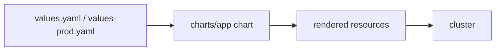

# 11-helm-12factor-chart

Services deployed by hand drift from what's actually running, and nobody
notices until it's too late. They get no autoscaling, so load spikes turn
into outages. And they lose capacity during routine node drains, because
nothing stops a cluster from evicting every replica at once.

This chart deploys a stateless 12-factor web app with the controls a senior
engineer would expect in production, without requiring a cluster to try it.

## Flow



## Controls

| Control | What it prevents | Template |
|---|---|---|
| HorizontalPodAutoscaler | Load spikes causing outages | templates/hpa.yaml |
| PodDisruptionBudget | Node drains dropping below minimum capacity | templates/pdb.yaml |
| NetworkPolicy | Unlabelled namespaces reaching the app | templates/networkpolicy.yaml |
| ExternalSecret | Secrets stored in plain values files or git | templates/externalsecret.yaml |
| preStop sleep + terminationGracePeriodSeconds | Dropped requests during pod shutdown | templates/deployment.yaml |

## Usage

```sh
helm lint charts/app
helm template charts/app
helm template charts/app -f charts/app/values-prod.yaml
```

## Status

Tested with helm lint, helm template, kubeconform and a rendered-output test
only. Not deployed to any cluster. Keep this line until a real deploy.

## Limits

- Nothing is deployed, so the HPA, PDB and NetworkPolicy behavior is only
  checked in the rendered YAML.
- External Secrets API version depends on the operator release, so it is
  pinned in values and checked against the operator's docs.
- No ingress or TLS.
